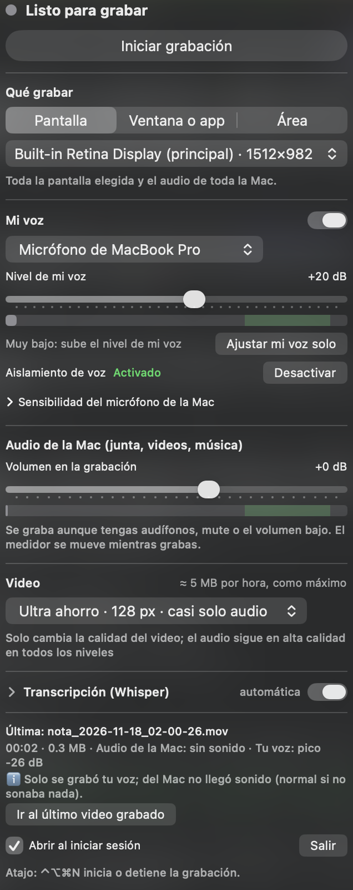

# Note-Taker-Mac-M5

**V2 de [Grabador-Pantalla-Mac-M5](https://github.com/JonathanFVC/Grabador-Pantalla-Mac-M5), ahora con Whisper.** Graba tu pantalla (completa, una ventana o un área), el audio de la Mac y tu micrófono **sin BlackHole**, y al terminar **transcribe la grabación solo, en tu Mac**, con Whisper. App de barra de menú y comando de terminal para Apple Silicon.

## Notas principales

- **Al terminar cada grabación, Whisper transcribe solo y deja la transcripción en `Películas/Note-Taker/Note-Taker-Transcriptions`** (la carpeta `Movies` de tu usuario; Finder la muestra como «Películas»): `ULTIMA_TRANSCRIPCION.txt` siempre es la más reciente (y `ULTIMA_TRANSCRIPCION.srt`, con tiempos); cada grabación conserva además su propio `.txt` y `.srt`. Los videos quedan junto, en `Películas/Note-Taker/Note-Taker-Videos`.
- **Activa el «Aislamiento de voz», el supresor de ruido de macOS: es necesario al 100 % para tener la mayor precisión en la transcripción.** Así Whisper recibe tu voz limpia, sin el ruido de fondo ni las voces lejanas. Se activa una sola vez (macOS recuerda la elección para la app). En una prueba, el ruido de fondo entre frases bajó de −44.8 a −108.5 dB conservando la voz. **Pasos exactos: [Cómo activar el Aislamiento de voz](#cómo-activar-el-aislamiento-de-voz-paso-a-paso).**
- **Dile a tu IA de preferencia que, con esa transcripción, te arme un «Resumen ejecutivo»: saldrá muy preciso**, porque el resumen parte de lo que realmente se dijo en la junta y no de tus notas ni de tu memoria. El botón **«Copiar transcripción»** del panel la deja lista para pegar. Prompt sugerido:

  > Con la transcripción de esta junta, arma un «Resumen ejecutivo» en español: (1) objetivo y contexto en 2 o 3 líneas; (2) decisiones tomadas; (3) acuerdos y pendientes, con responsable y fecha si se mencionaron; (4) riesgos o bloqueos; (5) preguntas abiertas. Usa solo lo que está en la transcripción; si algo no se dijo, escribe «no se mencionó» y no lo inventes.

- **La transcripción y la grabación se quedan en tu Mac**: Whisper corre localmente. Solo sale de tu equipo lo que tú pegues en la IA que elijas.
- Whisper puede equivocarse en **nombres propios, siglas y términos técnicos**: revisa esos datos en el resumen antes de compartirlo.

## Qué es

Note Taker junta en un solo paso lo que normalmente son tres herramientas: un grabador de pantalla con el **audio interno de la Mac** (lo que `Cmd+Shift+5` no hace), tu **micrófono**, y la **transcripción** de lo grabado. Incluye:

- **App de barra de menú «Note Taker»** (`app/`): todo el ciclo se maneja desde el icono de la barra, sin abrir el panel completo.
- **Comando `note-taker`** (raíz): grabar la pantalla principal y transcribir desde la terminal.

<p align="center"></p>

## Qué hace

- **Elige qué grabar** («Qué grabar» en el panel, como en `Cmd+Shift+5`):
  - **Pantalla** completa, la que elijas si tienes varias (por omisión, la principal).
  - **Ventana o app**: pulsa «Elegir ventana…», **pasa el puntero sobre la ventana** que quieras (se resalta) y haz clic. Solo se graba esa ventana, aunque otras la tapen, **y el audio de su app**. Una pestaña del navegador equivale a la ventana del navegador. Si usas **Stage Manager**, también puedes elegir las ventanas de su columna: al elegirlas, su app pasa al centro (macOS no entrega bien el contenido de las miniaturas) y se graba a tamaño real.
  - **Área**: pulsa «Elegir área…» y **arrastra un rectángulo** sobre la pantalla (como en `Cmd+Shift+5`). Se graba ese rectángulo y el audio de toda la Mac.
  - Si pulsas «Iniciar grabación» en modo Ventana o Área sin haber elegido, se abre el selector y **empieza a grabar al elegir**. El modo no se recuerda: la app siempre abre en **Pantalla**.
- **Todo desde el icono de la barra de menú** (el panel solo hace falta para iniciar o cambiar ajustes):
  - Sin grabar: icono de onda. **Grabando: cuadrado rojo con el tiempo; un clic lo detiene y lo guarda.**
  - Guardando o transcribiendo: **rueda azul que gira**. Al terminar, aviso «Video transcrito» (en el panel si está abierto; si no, un aviso flotante bajo el icono).
  - Clic derecho: menú con «Iniciar grabación»/«Detener y guardar», «Mostrar panel» y «Salir».
- Graba el **audio del sistema** (se graba igual con audífonos Bluetooth, en mute o con el volumen al 5 %, porque ScreenCaptureKit lo toma antes del dispositivo de salida) y el **micrófono**, en un solo `.mov` con **una pista de audio mezclada** (AAC, 48 kHz, estéreo).
- **Micrófono integrado de la Mac por defecto**, aunque la entrada del sistema sea otra.
- **Transcribe con Whisper al terminar** (modelo `turbo`; idioma Español, English o detectar), con prioridad baja para no estorbar y **una sola transcripción a la vez** en toda la Mac (si pulsas varias veces, o llegan varias grabaciones, las demás esperan su turno). El interruptor de transcripción se puede activar o desactivar **incluso durante la grabación**; el botón **«Transcribir último video grabado»** transcribe después el video más reciente y un aviso dice **«Último video transcrito»** (verde) o **«no transcrito»** (rojo).
- **Nivel de tu voz y del audio de la Mac** con medidores y «Ajustar mi voz solo» *(solo en la app)*.
- **Aislamiento de voz de macOS** *(solo en la app)*: macOS **no permite activarlo por código**: el botón abre su menú y ahí se elige; macOS recuerda la elección **por app**.
- **Niveles de video** (solo cambian el video; el audio no cambia):

  | Nivel | Ancho | Cuadros por segundo | Espacio, como máximo, con la pantalla en movimiento |
  |---|---|---|---|
  | Ultra ahorro | 128 px | 1 | ≈ 5 MB por hora (casi solo audio) |
  | **Baja** (por defecto) | 960 px | 30 | ≈ 320 MB por hora |
  | Media | 1280 px | 30 | ≈ 715 MB por hora |
  | Alta | 1920 px | 30 | ≈ 2.2 GB por hora |

  (Con una ventana o un área, el ancho es el del contenido, sin agrandarlo.) El audio ocupa aparte ≈ 60 MB por hora. Con la pantalla quieta (diapositivas, texto) el video pesa mucho menos.
- Atajo global **⌃⌥⌘N** para iniciar y detener *(solo en la app)*. El panel se cierra solo al iniciar la grabación.

## Dónde quedan los archivos

| Qué | Dónde |
|---|---|
| Videos | `~/Movies/Note-Taker/Note-Taker-Videos/nota_AAAA-MM-DD_HH-MM-SS.mov` |
| Transcripciones | `~/Movies/Note-Taker/Note-Taker-Transcriptions/nota_….txt` y `nota_….srt` |
| **La última transcripción** | `~/Movies/Note-Taker/Note-Taker-Transcriptions/ULTIMA_TRANSCRIPCION.txt` (y `.srt`) |
| Whisper (entorno de Python y modelo `turbo`, ≈ 2.4 GB) | `~/.note-taker/whisper/` (borrar esa carpeta lo desinstala) |
| Registros y temporales | `~/.note-taker/registros/` (`app.log`, `transcripcion.log`) y `~/.note-taker/temporal/` |

## Requisitos

- Mac con Apple Silicon y **macOS 15 o posterior**. Probado en un MacBook Pro con chip M5 y macOS 26.7.1; **no se ha probado en otras Mac ni en Intel**.
- Herramientas de línea de comandos de Xcode (`xcode-select --install`).
- [Homebrew](https://brew.sh), para **ffmpeg** y **Python 3.12**.
- **Whisper** (`openai-whisper`): `instalar_whisper.sh` lo instala dentro de `~/.note-taker/whisper/` junto con el modelo `turbo` (≈ 1.6 GB, se baja una vez). Es el único modelo que usa Note Taker. Probado con Python 3.12, openai-whisper 20250625 y torch 2.15; **el instalador se probó en una Mac que ya tenía el entorno y el modelo, no desde cero**.

## Instalación

```bash
git clone https://github.com/JonathanFVC/Note-Taker-Mac-M5.git
cd Note-Taker-Mac-M5

bash instalar_whisper.sh                   # Whisper y el modelo turbo en ~/.note-taker/whisper
bash note_taker_cli_compilar.sh            # instala el comando en ~/.local/bin/note-taker
bash app/note_taker_app_compilar.sh        # arma ~/Applications/NoteTaker.app

open ~/Applications/NoteTaker.app
```

La primera vez, macOS pedirá permisos para «NoteTaker»:

1. **Grabación de pantalla y audio del sistema** (Ajustes del Sistema › Privacidad y seguridad). Actívalo y pulsa **«Reiniciar app»** en el panel.
2. **Micrófono.**

Si ya tienes Whisper en otro entorno de Python y solo quieres el comando, la variable `NOTE_TAKER_PYTHON` (ruta del `python` de ese entorno) sirve para la terminal; la app, al abrirse desde Finder, no hereda variables de la terminal y usa `~/.note-taker/whisper/entorno`.

**Último paso, necesario para la mayor precisión: activa el «Aislamiento de voz»** (se hace una sola vez; los pasos están justo abajo).

### Permisos y firma

La app se firma localmente (sin certificado de desarrollador) con un **requisito de firma fijo** (`designated => identifier "local.notetaker"`): así macOS no ata el permiso a cada compilación y **no vuelve a pedirlo al recompilar**. Si el permiso se atora:

```bash
tccutil reset ScreenCapture local.notetaker
tccutil reset Microphone local.notetaker
```

## Cómo activar el Aislamiento de voz (paso a paso)

El Aislamiento de voz es el supresor de ruido de macOS: quita el ruido de fondo y las voces lejanas de tu micrófono. **Hay que activarlo una sola vez**; macOS lo recuerda para la app. Es necesario para la mayor precisión de la transcripción.

1. **Abre el panel:** haz clic en el icono de onda de Note Taker en la barra de menú. (Mientras el panel está abierto, macOS muestra una pastilla **naranja de micrófono**: es el «Modo de micrófono» y desaparece sola al cerrar el panel.)
2. En la sección **«Mi voz»** busca la fila **«Aislamiento de voz»**. Si todavía no está activo dice **«Desactivado»** en rojo. Pulsa el botón **Activar** de esa fila.
3. El panel se cierra solo y **macOS abre su propio menú** de la app, con el título «Modo de micrófono». Si esa fila aparece cerrada (con una flecha `›`), haz clic en ella para desplegar las opciones.
4. Haz clic en **«Aislamiento de voz»**: queda marcado en naranja. (Ignora el botón «Dejar de compartir» de ese menú: es el aviso de macOS de que la app está capturando la pantalla.)
5. Cierra el menú haciendo clic fuera de él o con la tecla `Esc`.
6. **Compruébalo:** abre el panel otra vez. La fila debe decir **«Activado»** en verde. Desde ese momento todas tus grabaciones lo usan.

**Para desactivarlo:** repite los pasos (el botón ahora dice **Desactivar**) y elige **«Estándar»** en el menú de macOS.

**Si el menú de macOS no se abre o la fila muestra «…»:** el micrófono debe estar en uso para que macOS ofrezca los modos. Con el panel abierto basta, pero espera un segundo a que arranque. Otra vía: inicia una grabación y, mientras graba, abre el **Centro de control** de macOS (arriba a la derecha), pulsa **Modo de micrófono** y elige **«Aislamiento de voz»**.

**Notas:**
- macOS no permite que una app active este modo por código; por eso el botón abre el menú del sistema y la elección la haces tú.
- La elección es **por app**: si usas también otra app de grabación, ahí se configura aparte.
- Según Apple, los modos de micrófono están disponibles en las Mac de 2018 en adelante.
- El **comando de terminal** captura el micrófono por ScreenCaptureKit, que no ofrece estos modos: para usar el Aislamiento de voz graba con la app.

## Uso

**App:** clic en el icono de onda de la barra de menú abre el panel (**Qué grabar**, voz, audio de la Mac, calidad de video y **Transcripción (Whisper)**, esta última plegada: se despliega con su flecha). Todo el panel se desplaza junto cuando no cabe. Para grabar: «Iniciar grabación» o **⌃⌥⌘N**; se detiene con un clic en el cuadrado rojo, el mismo atajo o «Detener y guardar» en el clic derecho. El arranque automático al iniciar sesión viene **apagado** (se activa desde el panel).

**Comando** (graba la pantalla principal, o la que indiques con `--pantalla`):

```bash
note-taker                      # graba; Ctrl+C detiene, guarda el .mov y lo transcribe
note-taker stop                 # detiene una grabación en curso (desde otra terminal)
note-taker --segundos 30        # se detiene solo
note-taker --sin-transcribir    # solo graba
```

| Opción | Qué hace |
|---|---|
| `--segundos N` | se detiene solo a los N segundos |
| `--sin-transcribir` | no transcribe con Whisper al terminar |
| `--idioma CODIGO` | idioma de la transcripción: `es` (por defecto), `en` o `auto` |
| `--sin-mic` | solo audio del sistema |
| `--mic-predeterminado` | usa la entrada elegida en el sistema (por defecto, el micrófono integrado) |
| `--mic-nombre TEXTO` | usa el micrófono cuyo nombre contenga TEXTO |
| `--calidad NIVEL` | del video: `ultra`, `baja` (por defecto), `media` o `alta` |
| `--nativa` | resolución nativa del video |
| `--fps N` | cuadros por segundo (por defecto, los del nivel) |
| `--pantalla N` | pantalla número N (por defecto, la principal) |
| `--salida DIR` | carpeta de salida del video (por defecto `~/Movies/Note-Taker/Note-Taker-Videos`) |
| `--conservar-crudo` | conserva el archivo con las pistas separadas (diagnóstico) |

**Esquema de URL de la app** (para Atajos de macOS o scripts; `notetaker://…`):

| Enlace | Qué hace |
|---|---|
| `iniciar`, `detener`, `alternar` | inicia, detiene o alterna la grabación |
| `icono` | como pulsar el icono: grabando = detiene; si no, abre o cierra el panel |
| `mostrar`, `ocultar` | abre o cierra el panel |
| `captura?modo=pantalla\|ventana\|area` | cambia «Qué grabar» |
| `pantalla?n=0\|1\|2…` | elige la pantalla (0 = la principal) |
| `ventana?app=TEXTO` | elige la ventana más al frente cuya app o título contenga TEXTO; `ventana-elegir` abre el selector con el puntero |
| `area?x=&y=&w=&h=` | fija el área (puntos, origen arriba a la izquierda); `area-elegir` abre el selector de arrastre |
| `transcribir?n=0\|1` | apaga o enciende la transcripción automática |
| `transcribir-ultimo` | transcribe el último video grabado |
| `calidad?n=0..3` | 0 Ultra ahorro, 1 Baja, 2 Media, 3 Alta |
| `mic?db=N`, `sistema?db=N` | nivel de tu voz (0 a 36 dB) y del audio de la Mac (−18 a 12 dB) |
| `calibrar`, `modo` | ajusta tu voz solo; abre el menú de modos de micrófono |
| `panel-transcripcion?n=0\|1` | pliega o despliega la sección de transcripción |
| `actualizar` | vuelve a leer las pantallas |
| `ventana-prueba`, `area-prueba` | pruebas: simulan el puntero o el arrastre del selector |

También puedes transcribir cualquier video o audio con el script suelto: `~/.note-taker/whisper/entorno/bin/python transcribir/note_taker_transcribir.py archivo.mov --lang es --ultima`.

## Cómo funciona

`SCStream` entrega pantalla (con `SCContentFilter` de una pantalla, de una ventana o, para un área, de la pantalla con `sourceRect`) y audio del sistema; en la app el micrófono entra por `AVCaptureSession` (con la hora de cada bloque calculada por conteo de muestras) y en el comando, por ScreenCaptureKit. Un `AVAssetWriter` propio escribe las pistas por separado en fragmentos de 10 s y, al detener, `ffmpeg` mezcla las dos pistas de audio (`amix` con `alimiter`) y copia el video sin recodificarlo. Después se lanza `note_taker_transcribir.py` (Python + `openai-whisper`, modelo `turbo`, en la GPU de Apple Silicon con MPS, sin arrastrar el texto anterior como contexto para evitar omisiones y repeticiones) con `nice` para dejar la Mac libre; un cerrojo de archivo garantiza una sola transcripción a la vez. Con el panel abierto, la app solo escucha el micrófono (para el medidor y el Aislamiento de voz); no abre una captura de pantalla hasta que grabas.

## Limitaciones y trampas conocidas

- **Contenido con DRM** (Netflix, Spotify, etc.) no se puede grabar.
- **Mientras se graba, macOS muestra su indicador morado de captura de pantalla** en la barra de menú: es del sistema (privacidad) y ninguna app puede ocultarlo. Con la barra muy llena, macOS puede ocultar algún botón; si el tiempo no cabe junto al cuadrado rojo, la app deja solo el cuadrado.
- **El medidor «Audio de la Mac» solo se mueve mientras grabas** (con el panel abierto solo se mide el micrófono).
- **Una ventana grabada capta solo el audio de su app**; una **pestaña** no se puede grabar sola (se graba la ventana del navegador). macOS solo permite grabar ventanas visibles: no las minimizadas ni las de otro Espacio.
- **La app todavía no evita que la Mac se duerma** por inactividad mientras graba (el comando sí). Una llamada de Meet o Zoom ya la mantiene despierta.
- **Sin el Aislamiento de voz activado**, el ruido de fondo y las voces lejanas llegan al micrófono y a Whisper, y baja la precisión de la transcripción.
- **Whisper:** si el inicio de la grabación es música o ruido, o no hay voz, el modelo puede inventar texto («¡Suscríbete al canal!», «¡Gracias!»); con voces sintéticas o muy superpuestas se equivoca más. En un M5 el modelo `turbo` va a ≈ 11 veces el tiempo real.
- `excludesCurrentProcessAudio` debe quedar en `false` (en `true`, macOS silencia lo que suene desde la app o terminal que lanzó el comando).
- En `CMSampleTimingInfo` la duración es **por muestra**, no por bloque.
- `showSystemUserInterface` (el menú de modos de micrófono) no abre nada si la app no está activa.
- **Sin probar todavía:** juntas reales de Meet o Zoom, grabaciones de 40 minutos o más (hay reportes en foros de Apple de cierres de ScreenCaptureKit tras varios minutos) ni su transcripción, **una segunda pantalla** (monitor externo), conectar y desconectar audífonos en caliente, Esc y clic derecho de los selectores de ventana y de área (los selectores se probaron con el puntero y el arrastre simulados dentro de la app), apps con varias ventanas en la columna de Stage Manager, y la instalación de Whisper desde cero.

## Estructura

```
note_taker_cli.swift                      comando de terminal
note_taker_cli_compilar.sh                instala el comando y el script de Whisper
instalar_whisper.sh                       crea ~/.note-taker/whisper (entorno y modelo turbo)
transcribir/note_taker_transcribir.py     transcribe con Whisper y deja ULTIMA_TRANSCRIPCION
app/note_taker_app_motor.swift            captura, escritor de archivo y mezcla
app/note_taker_app_captura.swift          qué grabar: pantalla, ventana o área
app/note_taker_app_selector_area.swift    selector de área (arrastrar)
app/note_taker_app_selector_ventana.swift selector de ventana con el puntero
app/note_taker_app_aviso.swift            rueda de carga, botón de stop y avisos
app/note_taker_app_vista.swift            ajustes y panel (SwiftUI)
app/note_taker_app_principal.swift        barra de menú, atajo, URL, permisos y arranque de Whisper
app/note_taker_app_transcriptor.swift     lanza Whisper y reporta el estado
app/note_taker_app_compilar.sh            arma y firma la app
imagenes/panel-note-taker.png             captura del panel
```

## Licencia

MIT. Consulta [LICENSE](LICENSE).
